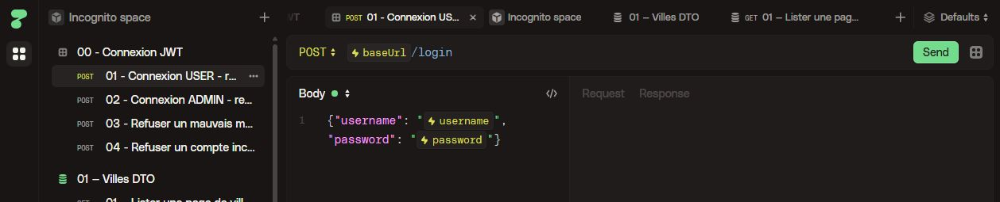
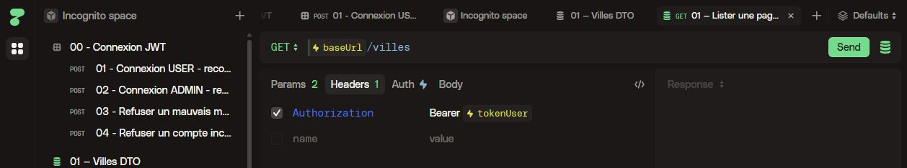
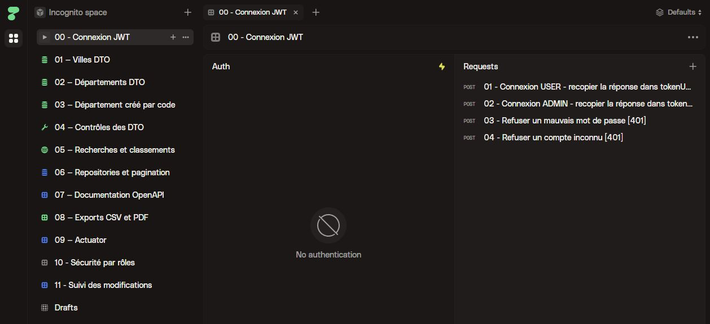
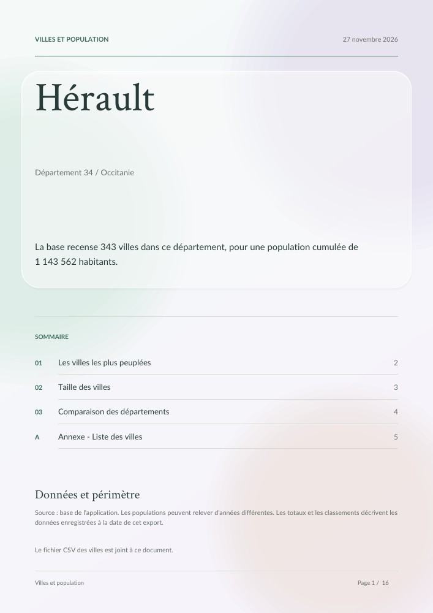

# Utiliser la collection HTTPie

Le fichier [projet-spring.httpie.json](projet-spring.httpie.json) contient les requêtes de l'API, rangées par usage.
Le nombre entre crochets dans leur nom, par exemple `[200]` ou `[404]`, indique la réponse attendue.
Une requête prévue pour renvoyer une erreur permet de vérifier que le contrôle fonctionne.

## Commencer

1. Démarrer MariaDB dans XAMPP, puis l'application dans IntelliJ.
2. Dans HTTPie Desktop, ouvrir **Import…** et choisir `projet-spring.httpie.json`.
3. Vérifier les [variables dans Defaults](#les-variables), en particulier `baseUrl` : `http://localhost:8080`.
4. Activer l'environnement **Default**.

## Se connecter

1. Ouvrir **00 - Connexion JWT** et envoyer la requête **Connexion USER**.
2. Copier le texte retourné dans la variable `tokenUser` de **Defaults**.
3. Faire la même chose avec **Connexion ADMIN** et la variable `tokenAdmin`.
4. Ouvrir une autre collection et envoyer une requête avec **Send**.

La connexion envoie les identifiants dans **Body**, au format **Text / JSON**.
Les blocs jaunes représentent des variables : HTTPie remplace leur nom par leur valeur avant l'envoi.



Copier le token. Il reste valable 15 minutes.
Les autres requêtes possèdent déjà leur header **Authorization** : `Bearer {{tokenUser}}` pour les lectures,
`Bearer {{tokenAdmin}}` pour les écritures. La collection 10 utilise volontairement d'autres cas pour tester les refus.
L'onglet **Auth** reste sur **None**, car le header est déjà renseigné.



## Les collections



| Collection | À quoi elle sert | Réponse réelle |
| --- | --- | --- |
| **00 - Connexion JWT** | Obtenir les tokens USER et ADMIN. Vérifier aussi le refus d'un mauvais mot de passe et d'un compte inconnu. | [200](#reponse-00) |
| **01 - Villes DTO** | Créer une ville, la retrouver, la modifier, puis la supprimer. Tester un doublon et un identifiant inconnu. | [200 et 404](#reponse-01) |
| **02 - Départements DTO** | Consulter un département et ses villes. Créer un département, modifier son code et son nom, puis le supprimer. | [200](#reponse-02) |
| **03 - Département créé par code** | Créer une ville avec un nouveau code département. Le serveur crée le département automatiquement. Supprimer ensuite la ville avant le département. | [200 et 409](#reponse-03) |
| **04 - Contrôles des DTO** | Envoyer des données incorrectes : nom absent ou trop court, population à zéro, références absentes ou incohérentes. Lire les erreurs retournées. | [400](#reponse-04) |
| **05 - Recherches et classements** | Filtrer les villes par début de nom ou population et retrouver les plus grandes villes d'un département. Les bornes de population sont exclues. | [200](#reponse-05) |
| **06 - Repositories et pagination** | Changer le numéro et la taille d'une page, vérifier les limites et le tri par population décroissante. | [200](#reponse-06) |
| **07 - Documentation OpenAPI** | Récupérer la description des routes au format JSON ou YAML. | [200](#reponse-07) |
| **08 - Exports CSV et PDF** | Télécharger les villes au-dessus d'une population donnée en CSV, ou le rapport PDF d'un département à partir de son code. | [CSV et PDF](#reponse-08) |
| **09 - Actuator** | Vérifier que l'application et la base répondent. Consulter les informations du projet et les mesures de mémoire et de threads Java. | [200](#reponse-09) |
| **10 - Sécurité par rôles** | Vérifier les accès USER et ADMIN, les refus d'écriture avec USER et le refus d'un token invalide. | [401 et 403](#reponse-10) |
| **11 - Suivi des modifications** | Vérifier `userMaj` et `dateMaj` après les créations et modifications. Retrouver les traces des écritures dans `logs/projet-spring.log`. | [200](#reponse-11) |

Un **DTO** est l'objet échangé en JSON avec l'API. Il contient les champs utiles au client.

Exécuter les requêtes d'une même collection dans l'ordre. Certaines utilisent les données créées juste avant.
Les collections 02 et 11 réutilisent `departementTestId` : recopier le nouvel identifiant à chaque création.
Faire de même pour `villeId` dans les collections 01 et 11.
Les dernières requêtes des scénarios suppriment les données créées pour l'essai.

## Les variables

Ouvrir le menu de l'environnement en haut à droite, puis **Manage environments**.
Dans un espace neuf sans variable, ce bouton peut s'appeler **Environments**.
Renseigner les valeurs dans la colonne **Defaults**.

| Variable | Valeur ou utilisation |
| --- | --- |
| `baseUrl` | Adresse de l'API : `http://localhost:8080`. |
| `username` / `password` | Compte USER de démonstration : `user` / `user1234`. Sert à la connexion. |
| `adminUsername` / `adminPassword` | Compte ADMIN de démonstration : `admin` / `admin1234`. Sert à la connexion. |
| `tokenUser` / `tokenAdmin` | Réponses des deux connexions. Vides dans le fichier d'import. |
| `villeId` | `id` de la ville créée dans le scénario en cours. |
| `departementId` | `id` d'un département existant, à choisir dans la réponse de `GET /departements`. La valeur importée est `74`, à adapter à sa base. |
| `regionId` | `id` d'une région existante, utilisé pour créer un département avec une région. La valeur importée est `33`, à adapter à sa base. |
| `departementTestId` | `id` du département créé dans la collection 02 ou 11. |
| `codeDepartement` | Code du département à exporter en PDF, par exemple `34` pour l'Hérault. |
| `codeDepartementAuto` | Nouveau code utilisé dans la collection 03 : `Z09` par défaut. Choisir un autre code s'il existe déjà. |
| `villeAutoId` | `id` de la ville créée dans la collection 03. |
| `departementAutoId` | `idDepartement` renvoyé avec cette même ville. |
| `page` | Numéro de page. `0` désigne la première. |
| `taillePage` | Nombre de villes par page : `20` par défaut, de `1` à `100`. |
| `populationMin` | Population minimale de l'export CSV : `100000` par défaut. |

Les identifiants de création valent `0` au départ. Cette valeur attend d'être remplacée par l'identifiant retourné par l'API.
HTTPie ne recopie pas automatiquement les identifiants ni les tokens dans cette collection.

## Comprendre la réponse

| Code | Ce qu'il indique dans ces scénarios |
| --- | --- |
| **200** | Requête réussie. Lire les données ou le token retourné. |
| **400** | Données refusées : vérifier le corps JSON et les paramètres. |
| **401** | Connexion absente, identifiants incorrects ou token invalide ou expiré. Refaire la connexion si nécessaire. |
| **403** | Compte connecté sans le rôle demandé. Une écriture demande le token ADMIN. |
| **404** | Donnée ou route introuvable, ou recherche sans résultat. Vérifier aussi que les variables d'identifiant ne valent plus `0`. |
| **409** | Suppression d'un département encore lié à une ville. Supprimer d'abord la ville du scénario. |

## Réponses obtenues

Ouvrir un exemple pour voir la requête, le code HTTP et le contenu reçu.
Les en-têtes sans rapport avec l'exemple sont omis. Les extraits de grandes listes sont signalés.
Les identifiants et les dates dépendent de la base et du moment de l'essai.

Ces essais utilisent une copie de la base et deux comptes temporaires, `guide-user` et `guide-admin`.
Ils ont les mêmes rôles que les comptes `user` et `admin` habituels. La copie et les comptes sont retirés après les essais.


<a id="reponse-00"></a>

<details>
<summary>00 - Connexion JWT : 200</summary>

```http
POST /login

{
  "username": "guide-user",
  "password": "user1234"
}
```

```http
HTTP/1.1 200
Content-Type: text/plain;charset=UTF-8
```
Le corps est un JWT signé. Il commence par `eyJhbGciOiJIUzI1NiJ9.e...` (token tronqué ici).
Copier le token complet reçu dans HTTPie dans `tokenUser`.

</details>


<a id="reponse-01"></a>

<details>
<summary>01 - Villes : lire, créer, modifier et supprimer</summary>

```http
GET /villes?page=0&size=2
```

```http
HTTP/1.1 200
Content-Type: application/json

{
  "content": [
    {
      "codeDepartement": "01",
      "dateMaj": null,
      "id": 40,
      "idDepartement": 40,
      "nom": "L' Abergement-Clémenciat",
      "population": 785,
      "userMaj": null
    },
    {
      "codeDepartement": "01",
      "dateMaj": null,
      "id": 41,
      "idDepartement": 40,
      "nom": "L' Abergement-de-Varey",
      "population": 244,
      "userMaj": null
    }
  ],
  "page": {
    "size": 2,
    "number": 0,
    "totalElements": 35350,
    "totalPages": 17675
  }
}
```

Création. L'API retourne la liste complète ; seul l'objet créé est repris ici.

```http
POST /villes

{
  "nom": "Ville HTTPie démonstration",
  "population": 1500,
  "idDepartement": 74
}
```

```http
HTTP/1.1 200
Content-Type: application/json

{
  "codeDepartement": "34",
  "dateMaj": "2026-11-27T15:59:53.4873027",
  "id": 35498,
  "idDepartement": 74,
  "nom": "Ville HTTPie démonstration",
  "population": 1500,
  "userMaj": "guide-admin"
}
```

Modification de la population. Même principe : extrait de l'objet modifié dans la liste retournée.

```http
PUT /villes/35498

{
  "nom": "Ville HTTPie démonstration",
  "population": 2000,
  "idDepartement": 74
}
```

```http
HTTP/1.1 200
Content-Type: application/json

{
  "codeDepartement": "34",
  "dateMaj": "2026-11-27T15:59:55.0024408",
  "id": 35498,
  "idDepartement": 74,
  "nom": "Ville HTTPie démonstration",
  "population": 2000,
  "userMaj": "guide-admin"
}
```

La suppression retourne 200 et la liste restante. Une nouvelle lecture du même identifiant retourne ensuite 404.

```http
DELETE /villes/35498
```

```http
HTTP/1.1 200
Content-Type: application/json
```

```http
GET /villes/35498
```

```http
HTTP/1.1 404
Content-Type: text/plain;charset=UTF-8

Ville introuvable
```

</details>


<a id="reponse-02"></a>

<details>
<summary>02 - Département : 200</summary>

```http
GET /departements/74
```

```http
HTTP/1.1 200
Content-Type: application/json

{
  "code": "34",
  "dateMaj": null,
  "id": 74,
  "idRegion": 33,
  "nom": "Hérault",
  "userMaj": null
}
```

Ici, `74` est l'identifiant en base de l'Hérault. Son code départemental reste `34`.

</details>


<a id="reponse-03"></a>

<details>
<summary>03 - Département créé par code : 200 puis contrôle en 409</summary>

```http
POST /villes

{
  "nom": "Ville HTTPie automatique",
  "population": 1000,
  "codeDepartement": "ZHW"
}
```

Extrait de la liste retournée : la ville est associée au nouveau département.

```http
HTTP/1.1 200
Content-Type: application/json

{
  "codeDepartement": "ZHW",
  "dateMaj": "2026-11-27T15:59:58.120478",
  "id": 35499,
  "idDepartement": 224,
  "nom": "Ville HTTPie automatique",
  "population": 1000,
  "userMaj": "guide-admin"
}
```

```http
GET /departements/224
```

```http
HTTP/1.1 200
Content-Type: application/json

{
  "code": "ZHW",
  "dateMaj": "2026-11-27T15:59:58.116483",
  "id": 224,
  "idRegion": null,
  "nom": "Département ZHW",
  "userMaj": "guide-admin"
}
```

La suppression du département est refusée tant que la ville lui est liée.

```http
DELETE /departements/224
```

```http
HTTP/1.1 409
Content-Type: text/plain;charset=UTF-8

Impossible de supprimer un département qui contient des villes
```

</details>


<a id="reponse-04"></a>

<details>
<summary>04 - Validation : 400 et messages par champ</summary>

```http
POST /villes

{
  "nom": "X",
  "population": 0,
  "idDepartement": 74
}
```

```http
HTTP/1.1 400
Content-Type: application/json

{
  "nom": "Le nom de la ville doit contenir entre 2 et 255 caractères",
  "population": "La ville doit avoir au moins 1 habitant"
}
```

</details>


<a id="reponse-05"></a>

<details>
<summary>05 - Recherche par début de nom : 200</summary>

```http
GET /villes/recherche/nom?nom=Montp
```

Extrait : les deux premiers résultats sur 21 villes retournées.

```http
HTTP/1.1 200
Content-Type: application/json

[
  {
    "codeDepartement": "07",
    "dateMaj": null,
    "id": 2247,
    "idDepartement": 46,
    "nom": "Montpezat-sous-Bauzon",
    "population": 881,
    "userMaj": null
  },
  {
    "codeDepartement": "10",
    "dateMaj": null,
    "id": 3460,
    "idDepartement": 49,
    "nom": "Montpothier",
    "population": 344,
    "userMaj": null
  }
]
```

</details>


<a id="reponse-06"></a>

<details>
<summary>06 - Pagination : 200 et deuxième page</summary>

```http
GET /villes?page=1&size=2
```

```http
HTTP/1.1 200
Content-Type: application/json

{
  "content": [
    {
      "codeDepartement": "01",
      "dateMaj": null,
      "id": 42,
      "idDepartement": 40,
      "nom": "Ambérieu-en-Bugey",
      "population": 14081,
      "userMaj": null
    },
    {
      "codeDepartement": "01",
      "dateMaj": null,
      "id": 43,
      "idDepartement": 40,
      "nom": "Ambérieux-en-Dombes",
      "population": 1705,
      "userMaj": null
    }
  ],
  "page": {
    "size": 2,
    "number": 1,
    "totalElements": 35350,
    "totalPages": 17675
  }
}
```

`page.number` vaut `1` : il s'agit de la deuxième page, car la numérotation commence à zéro.

</details>


<a id="reponse-07"></a>

<details>
<summary>07 - Documentation OpenAPI : 200</summary>

```http
GET /v3/api-docs
```

Extrait du document reçu : sa version et la présentation de l'API. Le document complet contient aussi les routes et les schémas.

```http
HTTP/1.1 200
Content-Type: application/json

{
  "openapi": "3.0.1",
  "info": {
    "title": "API de recensement",
    "description": "API pour consulter et gérer les villes et les départements français. Elle permet de rechercher les villes par nom, population et département.",
    "contact": {
      "name": "Thibault Odor",
      "url": "https://github.com/thibaultodor/projet-spring"
    },
    "version": "1.0"
  }
}
```

</details>


<a id="reponse-08"></a>

<details>
<summary>08 - Exports : CSV et fichier PDF</summary>

```http
GET /villes/export/csv?min=1000000
```

```http
HTTP/1.1 200
Content-Type: text/csv;charset=UTF-8
Content-Disposition: attachment; filename="villes-min-1000000.csv"

Nom de la ville,Nombre d'habitants,Code département,Nom du département
"Paris",2190327,"75","Paris"
```

Le PDF est reçu comme fichier binaire, pas comme JSON. Voici ses en-têtes et la couverture du fichier téléchargé.

```http
GET /departements/34/export/pdf
```

```http
HTTP/1.1 200
Content-Type: application/pdf
Content-Disposition: attachment; filename="departement-34.pdf"
```

Le fichier reçu contient 16 pages et une pièce jointe `communes-34.csv`.



</details>


<a id="reponse-09"></a>

<details>
<summary>09 - Actuator : 200 et état UP</summary>

```http
GET /actuator/health
```

```http
HTTP/1.1 200
Content-Type: application/vnd.spring-boot.actuator.v3+json

{
  "groups": [
    "liveness",
    "readiness"
  ],
  "status": "UP"
}
```

</details>


<a id="reponse-10"></a>

<details>
<summary>10 - Sécurité : 401 sans token et 403 avec USER</summary>

Appel sans header `Authorization` :

```http
GET /villes
```

```http
HTTP/1.1 401
Content-Type: application/json

{
  "timestamp": "2026-11-27T15:01:35.220Z",
  "status": 401,
  "error": "Unauthorized",
  "path": "/villes"
}
```

Création envoyée avec un JWT USER valide : les données sont conformes, mais ce rôle ne peut pas écrire.

```http
POST /villes

{
  "nom": "Ville refusée",
  "population": 1500,
  "idDepartement": 74
}
```

```http
HTTP/1.1 403
Content-Type: application/json

{
  "timestamp": "2026-11-27T15:01:35.754Z",
  "status": 403,
  "error": "Forbidden",
  "path": "/villes"
}
```

</details>


<a id="reponse-11"></a>

<details>
<summary>11 - Signature remplie par le serveur : 200</summary>

```http
POST /villes

{
  "nom": "Ville HTTPie suivie",
  "population": 1200,
  "idDepartement": 74,
  "userMaj": "intrus",
  "dateMaj": "2000-01-01T00:00:00"
}
```

Après création, lecture de la ville pour vérifier sa signature :

```http
GET /villes/35500
```

```http
HTTP/1.1 200
Content-Type: application/json

{
  "codeDepartement": "34",
  "dateMaj": "2026-11-27T16:01:36.265551",
  "id": 35500,
  "idDepartement": 74,
  "nom": "Ville HTTPie suivie",
  "population": 1200,
  "userMaj": "guide-admin"
}
```

Le serveur a utilisé `guide-admin` et la date courante. Les valeurs `intrus` et `2000-01-01` envoyées par le client ont été ignorées.

</details>
